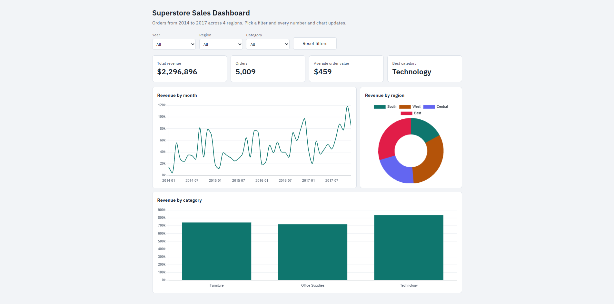
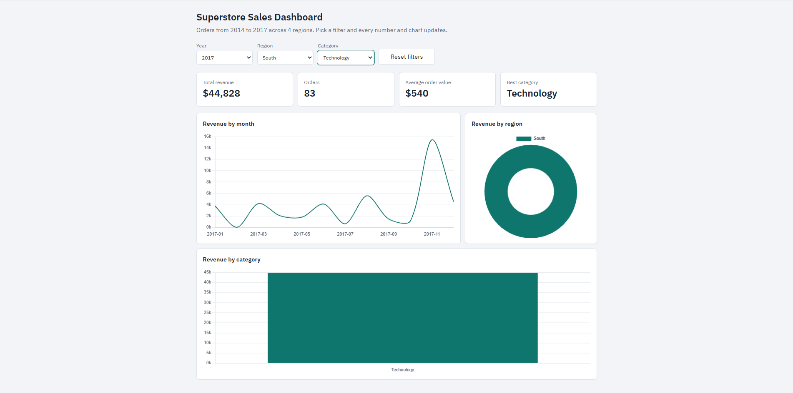
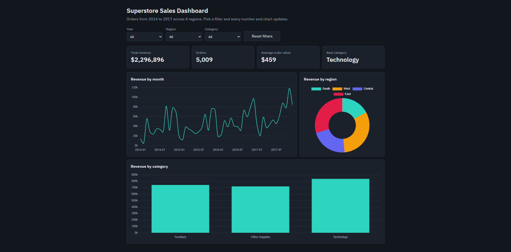

# Superstore Sales Dashboard

An interactive sales dashboard built on a real public retail dataset (the **Superstore** dataset from Kaggle). A Python script (pandas) cleans the raw CSV, and a plain HTML/CSS/JavaScript page (Chart.js) displays the result with live filters.

**Live demo:** https://osamamohamedgamal57-star.github.io/sales-dashboard/

**Data source:** [Superstore Dataset on Kaggle](https://www.kaggle.com/datasets/vivek468/superstore-dataset-final) (`vivek468/superstore-dataset-final`)



---

## Table of contents

1. [Features](#features)
2. [Screenshots](#screenshots)
3. [About the data](#about-the-data)
4. [How I built it](#how-i-built-it)
5. [What the data pipeline does](#what-the-data-pipeline-does-prepare_datapy)
6. [Proof that the cleaning ran](#proof-that-the-cleaning-ran)
7. [Tech stack](#tech-stack)
8. [Project structure](#project-structure)
9. [Run it locally](#run-it-locally)
10. [What I learned](#what-i-learned)

---

## Features

- Filter by **year**, **region** and **category**. The KPIs and all charts update instantly.
- Three charts: revenue by month (line), revenue by region (doughnut) and revenue by category (bar).
- Counts **unique orders** (not order lines) for the number of orders and the average order value.
- Responsive layout and automatic dark mode.
- Shows a clear message when no data matches the selected filters.

## Screenshots

**Full dashboard (all filters on "All")**


**With filters applied** (the numbers and charts change with the selection)



**Dark mode**



---

## About the data

- **Source:** the public Superstore dataset on Kaggle (link above). It is a well-known practice dataset for data analysis, so this project does not claim to show the sales of a real company.
- **I did not edit any numbers by hand.** The raw file is used exactly as downloaded. All changes are made by the script, `prepare_data.py`, so anyone can repeat them.
- **Two versions of the data are in this repo:**
  - `superstore.csv`: the raw file from Kaggle, unchanged.
  - `data.js`: the cleaned data that the website actually reads. It is generated from the raw file by `prepare_data.py`.
- **How to verify it yourself:** download the same dataset from Kaggle, compare it with `superstore.csv`, then run the script and compare its output with `data.js`.

---

## How I built it

1. **Chose a dataset.** I picked the Superstore dataset from Kaggle because it has dates, regions, categories and sales values, which suit a dashboard with filters.
2. **Explored the raw CSV.** I checked the columns and the number of rows (9,994) before writing any code.
3. **Wrote `prepare_data.py`.** It loads the CSV with pandas, validates the columns, removes duplicates, fixes text and dates, drops rows with missing values and exports `data.js`.
4. **Built `index.html`.** A single page with HTML, CSS and JavaScript. It reads `data.js` and draws the charts with Chart.js.
5. **Added the filters.** Changing the year, region or category recalculates the KPIs and redraws every chart.
6. **Published it.** I pushed the project to GitHub and turned on GitHub Pages for the live demo.

---

## What the data pipeline does (`prepare_data.py`)

1. Loads the CSV (falls back to `latin-1` encoding if needed).
2. Checks that the required columns exist and explains what to fix if not.
3. Removes duplicate rows and fixes inconsistent text.
4. Converts dates and numbers, and drops rows with missing values.
5. Adds year and month columns and writes `data.js`.

## Proof that the cleaning ran

This is the real output from running `python prepare_data.py` on the raw Kaggle file:

```
Loaded 9994 rows
Removed 2 duplicate rows
Dropped 0 rows with missing values
Years found: 2014 to 2017
Wrote 9992 clean rows to data.js
```

In short: 9,994 raw rows, 2 duplicates removed, no missing values, and 9,992 clean rows covering 2014 to 2017.

---

## Tech stack

Python, pandas, JavaScript (ES6), Chart.js, HTML5, CSS3 (Grid and Flexbox), GitHub Pages

## Project structure

```
sales-dashboard/
├── .gitignore
├── README.md
├── data.js                 # cleaned data used by the website
├── index.html              # the dashboard (HTML, CSS, JS, Chart.js)
├── prepare_data.py         # cleans the CSV and writes data.js
├── screenshot-dark.png     # dark mode screenshot
├── screenshot-filtered.png # filtered view screenshot
├── screenshot.png          # full dashboard screenshot
└── superstore.csv          # raw dataset from Kaggle (unchanged)
```

## Run it locally

1. The raw dataset `superstore.csv` is already included in this repo. Keep it in the location that `prepare_data.py` reads from.
2. In a terminal inside the project folder:

```
pip install pandas
python prepare_data.py
```

3. Open `index.html` in your browser. No server is needed.

---

## What I learned

I learned how to clean a real dataset with pandas, including removing duplicates and fixing dates. I connected a Python data pipeline to a JavaScript page that updates charts when filters change. I also published the project online with GitHub Pages.
